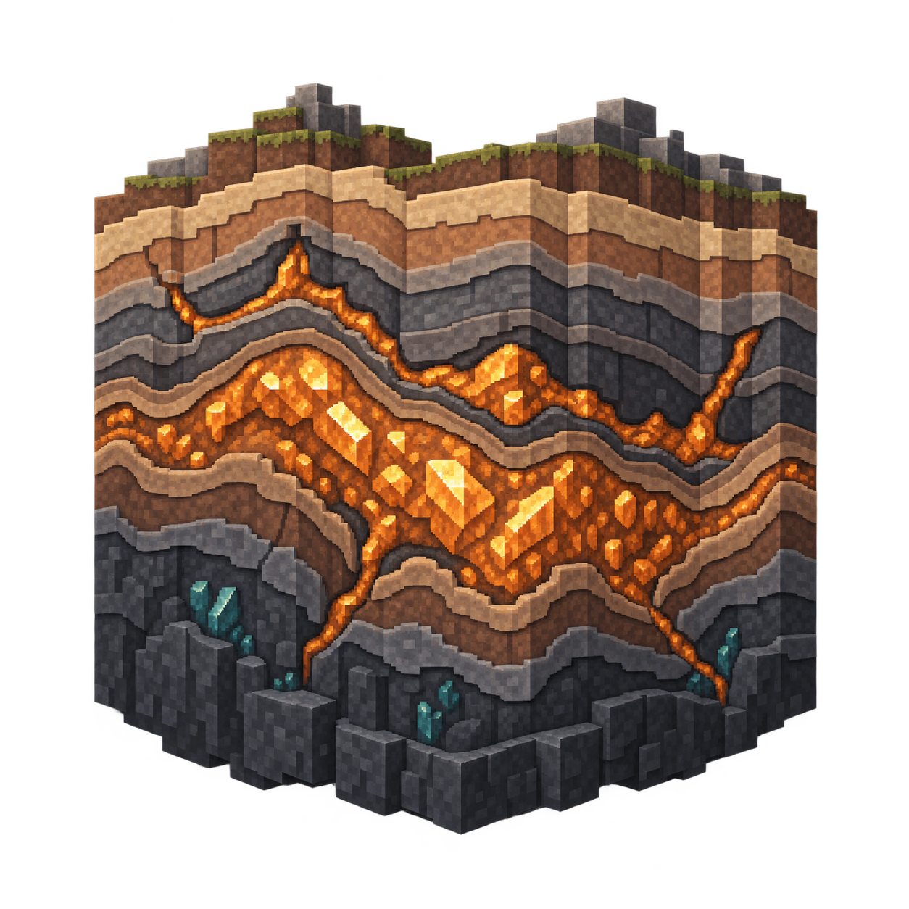

# Realistic Deposits

[](https://github.com/MinecraftModDevelopmentMods/RealisticDeposits/actions/workflows/ci.yml)
[](https://github.com/MinecraftModDevelopmentMods/RealisticDeposits/actions/workflows/codeql-analysis.yml)



Realistic Deposits is an extension for
[MMD OreSpawn](https://github.com/MinecraftModDevelopmentMods/OreSpawn) that
is being built to make valuable minerals feel like geological discoveries.
Instead of scattering a steady supply of small, isolated ore clusters
throughout the world, it plans rare formations large enough to reward
exploration and support sprawling mines, rail networks, and long-term resource
projects.

The project starts with Minecraft 1.10.2 and is intended to follow the
maintained OreSpawn branches across Forge and NeoForge.

The next update is a beta, adding coalfields and optional abandoned workings
alongside the existing iron districts. Back up your world before updating.

The coalfield work currently needs an unpublished OreSpawn API addition. It
is for local testing, not distribution; see [building from source](#building-from-source).

## Current features

- Rare, region-scale deposits that remain identical regardless of chunk
  generation order.
- Long, folded `stratiform_seam` formations instead of enlarged spherical ore
  blobs. The experimental iron default is a major mining district with an
  irregular principal horizon, five to seven splays, two or three subparallel
  lenses, and short fault displacements. A sparse halo gives prospecting clues
  around the fault gaps instead of making the displaced ore impossible to
  rediscover. Each chunk writes only its own deterministic part of a deposit.
- Massive-and-rare, geome-aware, and host-rock-aware generation modes.
- Coalfields with several thin beds, folds, fault offsets and local rock
  partings. Existing Mineralogy sedimentary rocks are used when available;
  Mineralogy is not required. See [coalfields](docs/COALFIELDS.md).
- Additive, hybrid, and replacement policies for controlling interaction with
  ordinary ore generation.
- Configurable support for vanilla and modded resources.
- Safe generation that avoids air, fluids, bedrock, block entities, structures,
  and undeclared host blocks.
- Live reload for geometry and alignment tuning, with structural changes
  clearly deferred until restart.
- An entry in both Forge's Mods configuration and OreSpawn's World Settings.
- Optional abandoned workings, with surface access and short seam-following
  galleries. They are off by default; see the [mine settings](docs/ABANDONED_MINES.md).

Coalfields can already use Mineralogy's existing shale, siltstone and
conglomerate. Wider catalogues for Mineralogy, Base Metals, Modern Metals,
Base Minerals and Base Gems remain future work.

## Requirements

The current branch requires:

- Minecraft 1.10.2;
- Forge 12.18.3.2511 or a compatible newer Forge 12 build;
- [MMD OreSpawn 4.1.3.110021](https://www.curseforge.com/minecraft/mc-mods/mmd-orespawn/files/9335434)
  or a newer compatible 1.10.2 release, but earlier than OreSpawn 5;
- Java 8 to run Minecraft.

For this coalfield development build, use the explicitly selected local
OreSpawn candidate instead of the public jar above. It retains the same version
number but contains the new exact-host API. The build checks its checksum and
prevents publication while that candidate is selected.

Realistic Deposits is independent of the similarly themed Large Ore Deposits
mod and does not require it.

## Configuration

Install Forge, OreSpawn, and Realistic Deposits in the usual `mods` directory.
The first launch creates:

```text
config/realisticdeposits/deposits/vanilla.json
config/realisticdeposits/deposits/coal.json
```

The supplied definition describes one rare iron district using a 640–960 block
folded horizon, a 160–240 block down-dip span, and a 3–8 block thickness. Its
`density` controls the disseminated halo around the connected mineralized
routes rather than producing a uniformly random cloud. Two or three faults
introduce short, recoverable breaks and modest vertical or lateral offsets.
The shipped iron definition uses `hybrid` interaction with 15% background iron
so early play remains viable while a discovered district can support a
long-lived mine and rail network.

The separate coal catalogue adds two to four beds across a large coalfield,
keeping 15% ordinary background coal. It favours sedimentary and wetland basins
while allowing sedimentary cover in some other geological regions. Coalfields
use plain stone without physical strata, or suitable existing sedimentary
rocks when those strata are active. Old catalogues are never overwritten, and
old worlds do not receive new coal rules automatically.

Deposits only affect newly generated chunks. Changing these settings does not
retrogen, replace, or rewrite an existing chunk.

Every definition chooses one alignment mode:

- `massive_rare` selects formations without requiring OreSpawn geology;
- `geome_aligned` requires the formation centre to be in one of its configured
  `geomes`;
- `rock_aligned` also requires each output block to be in one of its configured
  `rock_families`.

Aligned candidates are safely rejected if the current dimension has no active
OreSpawn geology sampler. The available families are `sedimentary`,
`metamorphic`, `igneous_intrusive`, and `igneous_volcanic`.

The `interaction` field controls ordinary generation for the same resource and
dimension:

- `additive` leaves it unchanged;
- `hybrid` scales it to 25% by default, or to
  `background_generation_scale` when specified;
- `replacement` disables it while leaving the massive deposit active.

OreSpawn 4.1.3 applies those limits to imported OS1/OS3 ordinary rules too.
Explicit custom placement channels remain independent. Manage Vanilla Ores
must be on to activate imported vanilla rules. When it is off, those rules
stay inactive and Minecraft supplies the ordinary placements instead.
Realistic Deposits' selected policy still controls the background supply.
Saved settings and existing chunks are preserved.

Biome IDs and Forge biome-dictionary filters can be supplied with `biome_ids`,
`excluded_biome_ids`, `biome_dictionary`, and
`excluded_biome_dictionary`.

Use the diagnostic commands to inspect the loaded catalog and preview planned
formations:

```text
/realisticdeposits status
/realisticdeposits preview <regionX> <regionZ> [deposit-id]
/realisticdeposits reload
```

`reload` requires operator permission. It immediately applies `enabled`,
selection, shape, height, geome, family, and alignment changes. Resource,
dimension, host, biome-filter, interaction-policy, scale, added, and removed
definition changes are structural and take effect after restart. Abandoned-mine
settings are also captured with the world's deposit definition. New provider
entries are deliberately not injected into a world profile that already
exists.

The configuration screen is available from Forge's Mods list and OreSpawn's
World Settings screen.

## Building from source

The Gradle build runs on Java 17 and compiles the mod for Java 8 using the
configured toolchain. ForgeGradle's Minecraft preparation utility uses Java 25.

The released alpha uses `curse.maven:mmd-orespawn-245586:9335434`, the public
OreSpawn 4.1.3.110021 jar. That checksum-checked pin is retained for provenance,
but it does not contain the exact-host builder needed by this coalfield preview.
To build this checkout, select a sealed local candidate repository in ignored
`local.properties`:

```properties
orespawnCandidateRepository=path/to/local/candidate-repository
orespawnCandidateSha256=the-complete-candidate-sha256
```

The repository must supply `zone.moddev.mc.orespawn.candidate:OreSpawn:4.1.3.110021`.
The candidate is mapped for development automatically. Do not distribute this
combination: OreSpawn must release the API first, then this branch can pin the
new public file and checksum.

On Windows, run:

```powershell
.\gradlew.bat clean check build
.\gradlew.bat genEclipseRuns verifyEclipseProductionClasspath
```

Import the project into Eclipse through Buildship after generating the Forge
run configurations.

For a separate test world, use `runMajorIronClient.launch`. It keeps its saves
and configuration in `run-major-iron`, apart from the ordinary client launch.

The [generation qualification guide](tools/qualification/README.md) describes
the optional packaged-server checks for policies, imports and saved worlds.
The [mine-testing walkthrough](tools/qualification/MINES_TESTING.md) uses a
separate Eclipse profile and disposable saves for the new workings.
For coalfields, use `prepareCoalMeasuresManual` and the
[coal-testing walkthrough](tools/qualification/COAL_TESTING.md).

CI also checks reproducible jars, dependency hashes and ordinary Eclipse
launches. The [release guide](docs/RELEASING.md) explains the manual release
action and its publication checks.

Bug reports and feature ideas are welcome through the
[issue tracker](https://github.com/MinecraftModDevelopmentMods/RealisticDeposits/issues).

## Links

- [CurseForge project](https://www.curseforge.com/minecraft/mc-mods/realisticdeposits)
- [MMD OreSpawn](https://github.com/MinecraftModDevelopmentMods/OreSpawn)
- [Source repository](https://github.com/MinecraftModDevelopmentMods/RealisticDeposits)

## License

Realistic Deposits is licensed under the
[GNU Lesser General Public License version 2.1](LICENSE).
